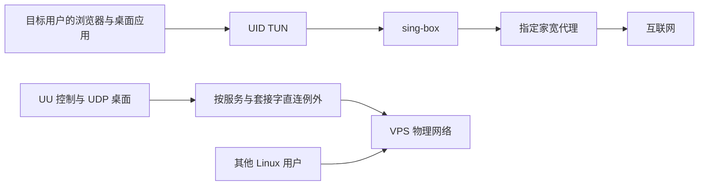

# UU VPS Home Proxy

独立的 **UU Linux 远程桌面 + VPS 按用户 TUN 家宽出口** 集成项目。普通浏览器和桌面应用走指定代理，UU 的控制及 UDP 桌面连接保留直连。

当前版本 **0.1.0**。Python 运行时只用标准库，代理与 TUN 复用 sing-box。UU Linux 主机由独立上游项目提供，本仓库包含网络管理工具、集成模板、部署文档和回归测试。

## 快速使用

已有桌面用户与 `uuremote-native.service` 时：

```bash
sudo python3 install.py --prefix /usr/local

# desktop 换成实际用户名；代理 URL 将隐藏输入
sudo uu-vps-proxy configure desktop --bypass-unit uuremote-native.service
sudo uu-vps-proxy on desktop
sudo uu-vps-proxy check desktop
```

仅安装程序不会改路由、不会启动或重启服务。新 VPS 的完整步骤见 [部署指南](docs/deployment.md)。

## 能力

- 按 Linux UID 接管现有桌面会话，其他用户保持原路由。
- SOCKS5、HTTP(S) 直接输入；其他 sing-box 协议从 `--profile` 导入单个 outbound JSON。
- 出口 IP/时区检查与固定，开机启动，状态与关闭回滚。
- 用户 DNS 转发、普通 IPv6 出站阻断和代理停止后的防直连回退。
- UU cgroup、控制服务器及实时 TCP/UDP 套接字例外，保留连接标记。
- 在 TUN 启用前保留已建立 UDP 端口的源地址选择，必要时对来自 TUN 网段的直连控制流量做源地址转换。
- 公共 STUN UDP 不会对所有浏览器放行。



## 管理命令

```bash
sudo uu-vps-proxy status desktop
sudo uu-vps-proxy check desktop
sudo uu-vps-proxy off desktop
sudo uu-vps-proxy on desktop

# 更换代理：先关闭，再明确替换
sudo uu-vps-proxy off desktop
sudo uu-vps-proxy configure desktop --replace
sudo uu-vps-proxy on desktop
```

默认隐藏输入认证，避免把密码写入命令历史。真实运行配置位于 `/etc/uu-vps-home-proxy/users/<用户>/`，目录 0700、文件 0600。状态输出不显示代理密码。不要把运行配置、UU 登录或 TURN 信息提交到仓库。

## 验证

```bash
python3 -m unittest discover -v
sudo env UU_VPS_INTEGRATION=1 python3 -m unittest discover -v
```

集成测试在隔离命名空间中复现 UDP 私网源地址导致的回包失败，并验证端口前置路由与源地址转换恢复往返，同时验证其他 UID 与普通浏览器 STUN 的边界。运行测试不会切换真实桌面 TUN。现场同等规则部署中，浏览器出口已验证，UU 桌面画面和操作由用户确认正常。详情见 [验证与边界](docs/validation.md)。

本仓库没有真实代理凭据、UU 登录数据、网易资源或第三方主机二进制。上游组件见 [THIRD_PARTY.md](THIRD_PARTY.md)。
